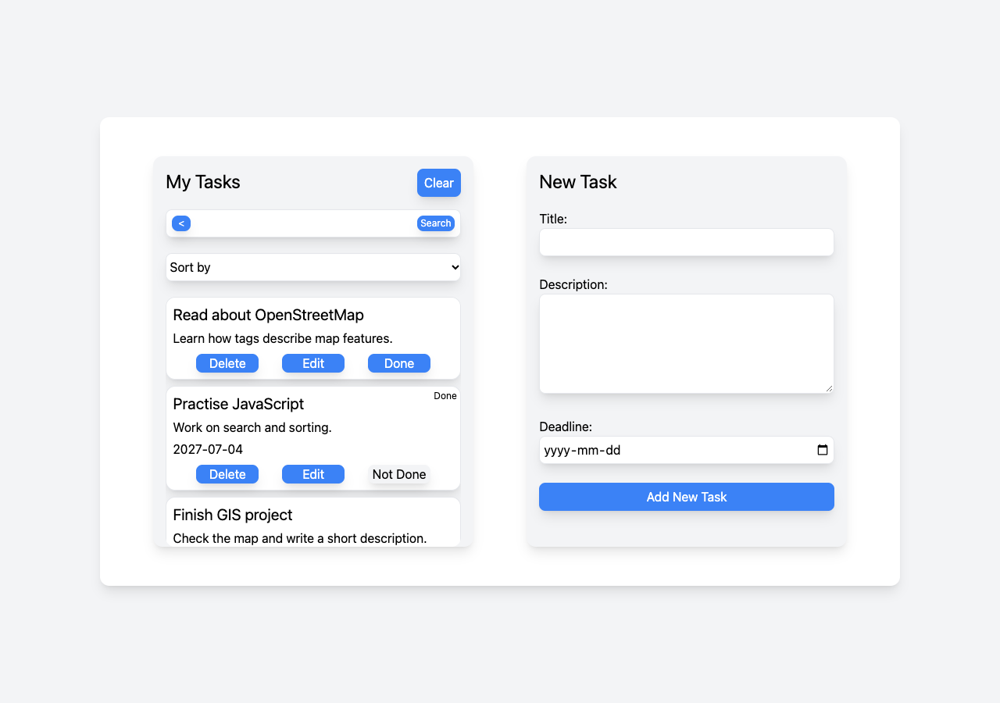

# To-do app

A small project I made to practise JavaScript, DOM manipulation and event listeners.

## What it does

- Add tasks with a title, description and optional deadline.
- Edit, delete and mark tasks as done.
- Save tasks in localStorage so they stay after refreshing or reopening the page in the same browser.
- Search by title, description or deadline. Click Search to apply the search.
- Sort by title or deadline. Tasks without a deadline go last when sorting by deadline.
- Reset sorting to show tasks in their original order, with the newest first.
- Clear all visible tasks. If a search is active, hidden tasks are kept. If nothing matches, Clear does nothing.

The arrow button next to the search field clears the search and resets sorting.

## How to run

Download this folder and open `index.html` in a browser. Keep `script.js` in the same folder.

The page uses Tailwind CSS through a CDN, so an internet connection is needed for the styling.

## Built with

- JavaScript
- HTML
- Tailwind CSS

## Things to improve later

- Improve the layout on small screens.
